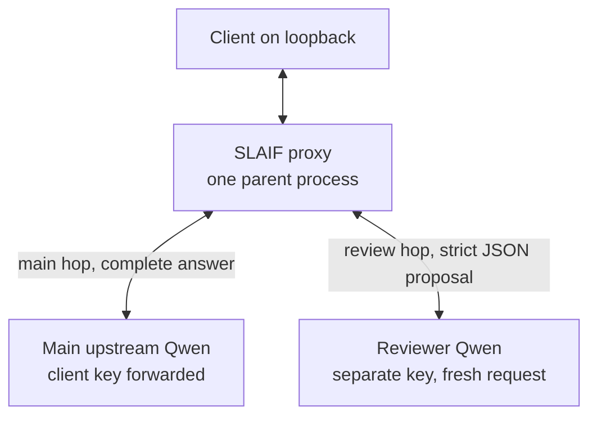
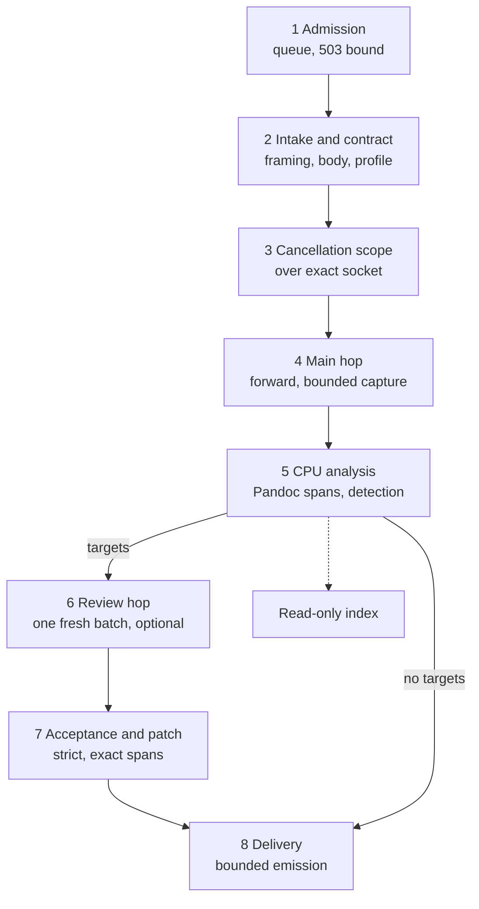
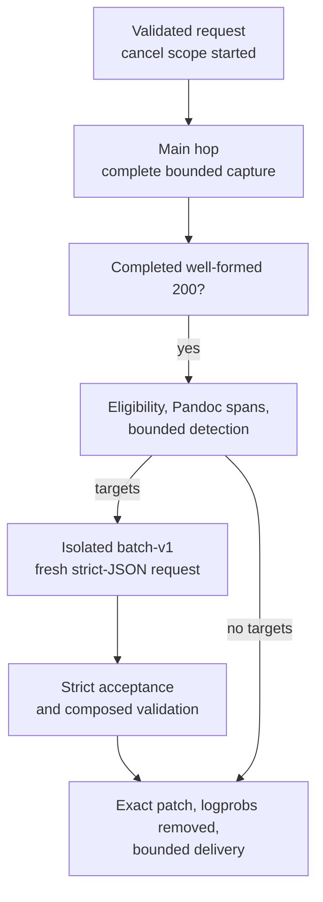
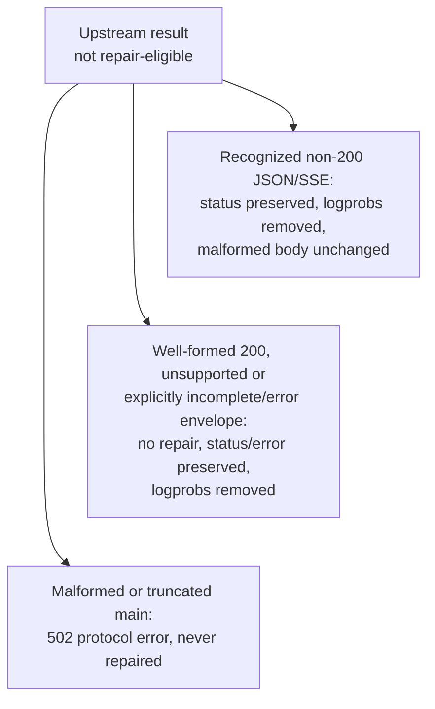
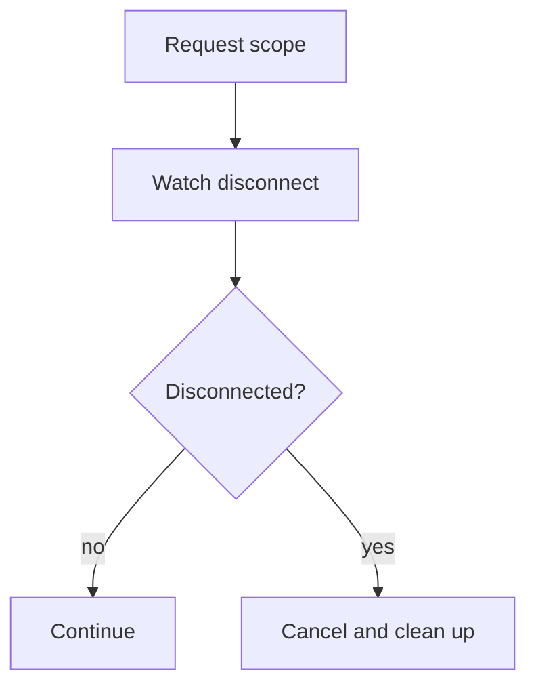

# SLAIF Slovenian Repair — Architecture

| | |
| --- | --- |
| Revision | 2.0, 2026-11-12 — current runnable architecture |
| Prior revision | 1.1, SHA-256 `a16e0f87bdb21f6920aa63119cf5be148b6c8b68bf1337c44006d54b7a7261f7` |
| Authorized base | `987fdb9ed07856d735f1e684f8af342461bf5236` |
| Product agreement | [PLAN.md](PLAN.md) — protected, unchanged by this revision |
| Compact projection | [ARCHITECTURE-for-agents.md](ARCHITECTURE-for-agents.md) |
| DHA register | [CRITICAL.md](CRITICAL.md) |

Revision 2.0 is a bounded, owner-authorized current-source evolution: it
re-describes the product as the **implemented runnable proxy**, separates real
runtime behavior from the historical library scaffold and from earlier engineering
proposals, adds diagrams of the system boundary, component ownership, the
request/repair lifecycle and cancellation, and reports the actual runtime values.
The stable invariants LR-001…LR-014 and their meanings are preserved; the change
record and revision law are in [§18](#18-change-control-and-revision-record).

On this page: [Purpose](#1-purpose-and-scope) · [Boundary](#2-system-boundary) ·
[Invariants](#3-fixed-product-invariants) · [Components](#4-components-and-module-ownership)
· [Lifecycle](#5-request-and-repair-lifecycle) · [Spans and
Pandoc](#6-text-spans-and-the-pandoc-original-mapping) · [Protection](#7-protected-material)
· [Evidence](#8-corpus-evidence-and-read-only-index) · [Detection](#9-cpu-detection-and-target-selection)
· [Review](#10-isolated-qwen-review) · [Acceptance](#11-strict-acceptance) ·
[Patching](#12-exact-patching-and-composed-validation) ·
[Metadata](#13-response-metadata-and-the-no-probability-policy) ·
[Resources](#14-bounded-resources-cancellation-and-failure) · [Security](#15-security-privacy-and-protected-environment)
· [Evidence limits](#16-evidence-boundaries) · [Document roles](#17-document-roles-and-authority)
· [Change control](#18-change-control-and-revision-record)

## 1. Purpose and scope

SLAIF Slovenian Repair is an **experimental local lab proxy**: an operator
installs it from this repository and runs it on loopback in the foreground. It is
not a hosted service, and deployment/release authority is distinct from software
correctness (LR-014) — nothing in this document claims a release.

The product completes Slovenian natural-language responses with conservative
malformed-form, morphology and contextual word/short-phrase repair:

1. It waits for a **complete** answer from an existing Responses API model.
2. It selects a few suspicious words or short phrases at exact original
   coordinates, bounded by CPU evidence from a read-only statistics index.
3. It optionally asks the same model, in a fresh isolated request, whether each
   target is natural and appropriate in context.
4. It applies a replacement only when independent CPU evidence supports it, and
   it preserves every code point outside the approved spans.

### 1.1 What is real, and what is a proposal

Three layers must not be conflated:

- **Runnable proxy (implemented):** the loopback proxy in `concept-verification/`.
  Sections 2–16 describe this.
- **Library scaffold (historical, not the entry point):** the separate `src/`
  package and the module boundaries in old §4.1 are historical engineering
  boundaries — not the runnable proxy and not a claim that a packaged library is
  implemented.
- **Engineering proposals (PLAN):** numeric module/contract choices, the
  eight-target default, and the `detect_only`/`shadow`/`strict`/`experimental`
  acceptance ladder were proposals. The runnable proxy implements a subset with
  its own verified limits; this document reports the actual values and does not
  present proposals as implemented.

## 2. System boundary

The product is a single **parent Python 3.12 process** bound to
`127.0.0.1:18024`. Its accepting loop hands each admitted connection to the one
fixed owned handler worker; bounded owned child processes are the only other
processes it starts: the one-shot DNS resolver for a **named** main-upstream
host (`upstream_setup.py`; an IP-literal host needs no resolver child), the
reviewer transport, and Pandoc. It sits between a local client and an existing,
operator-controlled Responses API model (Qwen), owns no conversation store, and
makes no public-network claim.

The proxy talks to the model through **two** routes:

- **Main hop** — the client's validated request is forwarded to the main
  upstream using the **client's** forwarded `Authorization`. The complete answer
  is captured and bounded before any repair work.
- **Isolated review hop** — a fresh, non-streaming reviewer request is sent to a
  private reviewer route using a **separate** reviewer key (`QWEN_API_KEY`). It
  never borrows the main conversation, never recurses through the public repair
  endpoint, and accepts no caller-supplied destination.

The CPU side also reads a **read-only SQLite evidence index** and invokes the
**mandatory pinned Pandoc 3.7.0.2** for structural protection. Neither is a
network resource; the index is opened read-only and never created or written.

Local CPU resources (no network): the **read-only SQLite evidence index**
(opened read-only, never created or written) and the **mandatory pinned Pandoc
3.7.0.2** (owned child, structural protection only).

The main hop and the review hop for one answer are **sequential**. Other users
may generate concurrently on the shared model, but this design makes no claim
that one proxy process adds GPU capacity.

## 3. Fixed product invariants

The identifiers LR-001…LR-014 are stable references for work orders, compact
views and tests. They express the agreed design and its safety boundaries; each
is implemented by the runnable proxy as described in the following sections. The
PLAN basis column is retained from revision 1.1 for traceability.

| ID | Mandatory invariant | PLAN basis |
| --- | --- | --- |
| LR-001 | Complete main generation and capture before CPU review, repair inference and delivery of answer text; verify supported upstream completion, not socket closure alone. No provisional original text to the user. | §§1, 3, 11.3 |
| LR-002 | CPU evidence chooses whether review is warranted; no eligible suspicion means zero review calls and unchanged text. Missing evidence does not prove error. | §§1, 7 |
| LR-003 | Review targets are preassigned words or short phrases at original coordinates, not model tokens or unrestricted sentences. | §§1, 7.2, 8 |
| LR-004 | Ask about the suitability of the specific expression; permit `keep` and `needs_wider_edit`; do not demand a change. | §8 |
| LR-005 | Construct a new isolated review request; never contaminate the main conversation, inherit its linkage, or recurse through repair. | §§4, 11.2 |
| LR-006 | Reviewer output is an untrusted local proposal; code validates and inserts replacements. The model never regenerates the answer. | §§8–10 |
| LR-007 | Preserve every original substring outside accepted spans, including protected material and original formatting. | §§5, 10 |
| LR-008 | Preserve `EXACT`, `CENSORED` and `UNAVAILABLE` evidence semantics; missing truncated data is not zero. | §6 |
| LR-009 | Strict acceptance needs appropriate independent evidence; frequency or self-reported model confidence alone is insufficient. | §9 |
| LR-010 | Use bounded, one-pass review; no automatic generative correction/retry loop. | §§3, 13 |
| LR-011 | Optional repair failure preserves an already safely captured original; never mask main errors, incomplete output or hard capture limits. | §13.3 |
| LR-012 | Reuse the existing Qwen; CPU-side repair infrastructure must not load another large GPU model or mutate the protected deployment. | §§1, 11–13 |
| LR-013 | Production logs contain no user text, target/replacement strings, prompts or secrets; evaluation is separately authorized. | §13.4 |
| LR-014 | Code correctness, model compatibility, linguistic benefit and deployment/release authority require separate evidence. | §§14–16 |

## 4. Components and module ownership

The proxy is one Python 3.12 parent process. The accepting loop never runs a
request itself: admission decides first, then the single fixed owned handler
worker handles each admitted connection end to end. Every request therefore runs
under one **per-request cancellation scope** over the exact accepted socket, and
no owned non-daemon worker or bound listener outlives the real entry point. The
modules below are the current runtime boundaries in `concept-verification/`:

| Stage | Module | Owns |
| --- | --- | --- |
| Admission | `request_admission.py` | Queue/socket handling **before** any handler work: 1 active + 16 waiting under one absolute monotonic queue deadline; one fixed content-free `503` before intake, forward, engine or review work |
| Intake | `client_transport.py` | Strict framing (`400`/`413`), bounded body read, body-completeness and intake-timeout rejections (`400`/`408`) — zero main work |
| Request contract | `responses_contract.py` | The supported request profile (§5.1); `400` rejections never reach main generation. Contract validation is **not** in `request_admission.py` |
| Cancellation | `request_lifecycle.py` | The one per-request scope over the exact accepted socket and its owned watcher |
| Main hop | `upstream_setup.py`, `header_transport.py`, `capture_transport.py` | Upstream connection (owned resolver child for named hosts) and bounded complete capture before any repair |
| Protection | `pandoc_protection.py` | The owned Pandoc child (pre-allocated `Popen`) and the granted/denied intervals; never renders the answer |
| Detection | `runtime_detection.py` | Bounded original-coordinate targets |
| Corpus | `runtime_corpus.py` | A strictly read-only index handle, opened only after the completed answer is admitted to analysis and closed on every path |
| Review | `batch_review.py`, `review_transport.py` | The batch-v1 body and one outbound request (owned child/IPC transport); never writes files or mutates conversation state |
| Acceptance and patch | `runtime_acceptance.py`, `composed_validation.py`, `repair.py` | Strict lexical acceptance, composed group recheck, exact patch |
| Delivery | handler worker in `proxy.py` | The final response under the delivery budget; the only place that turns a cancellation into the quiet abort |

Each phase owns its own bounded resources (owned child processes, sockets,
corpus handles, cursors, guard timers) and releases them on every path. The
processing order of the owned stages is:

The historical `src/` library and the module table in the old §4.1 are **not**
this entry point and are retained as historical boundaries, not a claim that a
packaged library exists.

## 5. Request and repair lifecycle

A request either fails **before** the main call (admission, intake or
request-contract rejection — zero main work) or, once the main answer is fully
and validly captured, enters the **optional** repair path. Optional repair
failure is a **fail-closed original**, not an error, and it can neither recover a
main failure nor change the original completion status.

Admission, intake and contract rejections happen first, with zero main work
(§5.2). From the validated request, one path is:

Completed 200 path:

Non-completed outcomes (same capture point):

### 5.1 Supported request profile

`POST /v1/responses` only (other paths `404`). Stateless input is either one
nonempty text string or a **client-managed text-only message sequence**: a
bounded number of messages, each exactly `role` + `content`, with `role` one of
`user`, `assistant`, `system` or `developer`, and `content` a nonempty bounded
string or a nonempty list of `input_text` parts. `store: false` is required;
`previous_response_id`, `conversation` and `incomplete_details` are rejected
(stored chaining is unsupported). No tools, function calls, images or structured
output; no request `logprobs` or `include`. `stream: false` returns JSON;
`stream: true` returns the documented delayed-SSE profile. Chat Completions and
health or models-list endpoints do not exist.

Client-managed history means the next turn's input is the client's own message
sequence carrying the **delivered final answer** from the previous turn: the
proxy never injects the original draft or reviewer messages and never rewrites
client input history. Main usage is preserved as reported; review usage is
separate, request-local and reset per request (unknown when absent or invalid —
never zero, never carried over); the edited answer length is not an inference
bill.

The repairable **completed output profile** is narrow and exactly typed.
`object: response`, exactly `status: completed`, and `error` absent or null.
Declarations: `store` and `background` absent, null or exactly boolean
`false` (nothing is coerced); `previous_response_id`, `conversation` and
`incomplete_details` absent or null. `output` is a list holding at most one
recognized noneditable reasoning item (completed or unmarked) preceding
exactly one assistant message: `role: assistant`, `status: completed`, `id` a
nonempty string, with exactly one `output_text` part holding a nonempty string
and `annotations` absent or `[]`. This response profile is a separate
contract from the §5.1 request profile. Conflicting statuses, extra answer
parts, tools/refusals, unknown output variants, nonempty aligned
`annotations` (metadata abstention) and malformed ids all decline repair: the
well-formed 200 passes through unchanged with zero calls and is **not** a main
failure (§5.2). Defined `logprobs` removal runs before and independently of
this eligibility check — it never gates, enables or changes repair (§13).

### 5.2 Failure and error contract

| Stage | Failure | Response | Main work |
| --- | --- | --- | --- |
| Admission | Queue full or 2 s wait deadline missed | fixed content-free `503` | none (before intake) |
| Intake framing | Repeated `Content-Length`, comma lists, any `Transfer-Encoding`, unsupported `Expect` | content-free `400` + close | none |
| Intake framing | Missing, nondecimal or over-large `Content-Length` (over 2,000,000 bytes) | `413` | none |
| Intake body | Fewer bytes delivered than advertised | `400` `REQUEST_BODY_INCOMPLETE` | none |
| Intake | Intake deadline expired mid-read | bounded best-effort `408` `REQUEST_INTAKE_TIMEOUT` | none |
| Request contract | Unsupported capability or invalid request | `400` `invalid_request` + bounded reason | none |
| Main hop | Upstream/setup/header/capture failure, truncated or incomplete SSE, over-limit body | `502` upstream protocol error | main attempted, no repair |
| Main hop | 200 mode mismatch (declared `stream` versus observed content type) | `502` `RESPONSE_MODE_MISMATCH` | main complete, no repair |
| Main hop | Malformed main JSON (invalid UTF-8, duplicate keys, nonfinite numbers, non-object) | `502` main error | main complete, no repair |
| Repair | Technical optional-stage failure (Pandoc, evidence, batch, transport); one rejected proposal is simply not applied | completed original for whole-pass failures; surviving edits delivered otherwise | main complete |

Completion is checked against the supported upstream protocol, not socket
closure (LR-001). A well-formed upstream envelope that is unsupported, or that
explicitly carries an incomplete or error status, is **not** a main failure:
its status, finish and error semantics are preserved through delivery while
defined `logprobs` are still removed (§13).

## 6. Text, spans and the Pandoc original mapping

Targets are addressed by Python-string **Unicode code-point** offsets into the
**unmodified original string**: `0 <= start < end <= len(text)` and
`text[start:end] == original`. Offsets are not UTF-8 bytes, UTF-16 units, or
model tokens. Each occurrence gets a stable response-local id (`t0…tN`); repeated
text has separate ids and exact per-occurrence context. A stale occurrence is
never relocated by first-substring matching. Qwen may not choose new positions,
invent ids, or extend a target.

### 6.1 The pinned Pandoc pipeline

The proxy runs the **mandatory pinned Pandoc 3.7.0.2** as an owned child with a
10-second budget, with the fixed reader profile `commonmark_x+sourcepos-smart`
writing `json` (`config.py: PANDOC_READER`/`PANDOC_WRITER`). Startup verifies the
exact version and the positioned-JSON capability **before** the proxy accepts
traffic; there is no runtime download, no historical-directory search and no
weaker parser fallback.

### 6.2 How positions are proven

- Positioned wrapper `Div`/`Span` nodes (and directly positioned elements
  `CodeBlock`, `Code`, `Link`, `Image`, `Header`) carry `data-pos` source
  positions; a bare `Str` leaf has no position of its own and is granted the
  position of its single-`Str` wrapper `Span`. Columns are **one-based
  code-point columns** with **four-column tab stops** (a tab starting at column
  `c` moves the next code point to column `((c-1)//4+1)*4+1`), as observed with
  the pinned binary.
- Positions are mapped back against **NFC line views**. Two failures are
  distinct: a line that changes under NFC denies grants for that **line only**
  (conservative abstention; the rest of the document is still processed), while
  a document-wide NFC line-decomposition inconsistency is a global integrity
  failure that rejects the mapping as a whole
  (`REASON_MAP_INTEGRITY`).
- A `Str` leaf is granted as editable prose only when the mapped slice is
  **exactly equal** to the parsed leaf content, contains **no grapheme-sensitive
  characters**, and both edit boundaries are **grapheme-stable** (no adjacent
  combining mark, ZWJ/ZWNJ or format character). An unproved position is never
  granted; the extent stays protected.
- Whitespace glue is granted only between two granted, **contiguous** prose spans
  in one proven shared prose context, never across a protected node or
  structural barrier.
- Unknown block structures are **denied by default**, region by region: an
  individual unproved region protects itself while the rest of the document may
  still be granted.

### 6.3 Granted prose, residual protection and failure modes

Protected material is the **complement of the granted prose** plus the residual
machine intervals (fenced/indented/inline code, URLs and link destinations,
emails, paths, commands, numbers/units, citations, quotations, HTML, equations,
metadata, markers, soft breaks and escapes). A residual fragment that begins in
protected syntax and extends into granted prose is retained **in full** — never
truncated at the grant boundary.

Two failure classes are distinct:

- **Region denial** — an unproved span or unknown structure is protected; the
  document is otherwise processed normally.
- **Whole-document failure** — nonzero Pandoc exit, malformed JSON, missing
  blocks, input over 1,000,000 bytes or output over 32,000,000 bytes fails the
  protection (`protect_with_pandoc` returns a non-ok outcome). Repair is then
  bypassed and the **completed original is delivered unchanged**; there is no
  retry, no substring relocation, and no AST rendering — Markdown
  **re-serialization is not** an acceptable patcher.

These boundaries are exercised by the frozen suite
`concept-verification/tests/test_pandoc_protection.py` (89 tests).

## 7. Protected material

The proxy selects only supported assistant `output_text` fields; it never
recursively repairs every string in a response. Reasoning, tools, function
arguments, ids, schemas, structured output, images, usage and binary data are not
editable. It protects fenced/indented/inline code, URLs and link destinations,
email addresses, paths, commands, numbers/units, citations, quotations, HTML,
equations, metadata, markers, soft breaks and escapes, and every unprovable
region. A protected interval is also a **linguistic boundary**: removing it must
never manufacture a new bigram or trigram across the text on either side.
Markdown parsing locates spans; Markdown **re-serialization is not** an
acceptable patcher — no AST re-render substitutes for the original document.

## 8. Corpus evidence and read-only index

Each evidence record preserves source/version, normalization, scope,
completeness/cutoff and one of three states:

| Status | Meaning |
| --- | --- |
| `EXACT` | The count is known for this query and declared scope; zero requires a source complete enough to justify it. |
| `CENSORED` | Only a range or threshold-derived bound is justified. Missing does not mean zero. |
| `UNAVAILABLE` | The source/query cannot support an interpretable value; abstain from that inference. |

The runtime index is a **read-only** SQLite database opened after admission and
closed on every path. It rejects WAL and creates no journal sidecars. Missing
words are `UNAVAILABLE`; missing n-grams are `CENSORED` with an **unknown**
denominator — never exact zero. A sum of retained n-grams is not a complete
denominator, and aggregating surface forms does not reconstruct a complete lemma
distribution. Comparisons require compatible source scope, normalization and
units. The real statistics are external CC BY-SA 4.0 data, not bundled; see
[INSTALL.md](INSTALL.md#statistics-licence-and-exact-downloads).

## 9. CPU detection and target selection

The runtime detector (`runtime_detection.py`) runs in the **`local-context`**
mode and produces **suspicion, not verdicts**. It works in four stages:

1. **Shared gate (before any target assignment).** Every candidate unit must
   pass one frozen lexical / maximal-original / grapheme gate: a single lexical
   unit that is not a fragment of a larger machine source unit (no adjoining
   combining mark, grapheme joiner, format or unsafe control character, digit or
   underscore). Ordinary prose boundaries — ASCII space/tab and the proven LF/CR
   terminators — stay eligible. Ineligible units remain in the raw token
   sequence, so the corpus query budget is unchanged and filtering cannot
   manufacture adjacency or consume the cap.
2. **One evidence pass over all tokens.** The detector collects corpus evidence
   for **all** raw tokens, in original order, in a single pass — including units
   that later turn out ineligible for review. This keeps the owned
   `RuntimeCorpus` on the exact deterministic SQL schedule of the frozen
   detector, and every later signal derives **only** from that already-collected
   evidence: no extra query, no re-query after a raw detect, no
   denominator/probability/entropy inference, no automatic replacement.
3. **Signals.**
   - *Frozen rare/unknown word signal* (legacy, unchanged): `UNAVAILABLE`
     unigram score 1.0, known count at most threshold 0.5, the local-context
     exact-local penalty; the score is rounded to six decimal places
     (`round(score, 6)`).
   - *Local-context WORD alarm* (score 0.4): the original and **both** immediate
     anchors are lowercase lexical units with `EXACT` unigram counts above the
     legacy threshold; both actual adjacent original bigrams are `EXACT`
     positive; the centered original trigram is `EXACT` with a known
     nonnegative count `C`; and the already-fetched fixed-neighbor alternatives
     contain a distinct casefolded middle lexical unit with count
     `A >= 2 * max(C, 1)`. Source gaps contain only ASCII spaces/tabs.
     `CENSORED`/`UNAVAILABLE` originals supply no signal; a missing row never
     means zero.
   - *Grouped PHRASE target* (score 0.45): maximal source-adjacent runs of
     actual word alarms are grouped **before** review. A one-unit run stays a
     word (only within 128 original code points); a 2–4 unit run within 128 code
     points becomes one exact original slice; over 4 units or over 128 code
     points yields **no** targets, and the run's context-only units stay
     excluded.
4. **Selection.** The runtime selects **at most four** non-overlapping targets
   per answer (`REVIEW_BATCH_MAX_ITEMS = 4`), in deterministic original order
   (hard cap 8 in the frozen selection; a safe non-positive maximum returns no
   targets). This is the actual value; the old §14.1 eight-target figure was an
   engineering proposal, not an implemented default.

## 10. Isolated Qwen review

One **versioned, occurrence-addressed reviewer batch** (`batch-v1`) runs per
completed eligible answer. It is a fresh, non-streaming request containing
compact instructions (at most 8,192 code points) plus exactly one serialized
JSON object of the targets and their bounded context (240 code points per
side). The material is untrusted **data**, including any embedded instructions;
there are no tools, no `previous_response_id`, no main-history linkage, and no
recursion through the public repair endpoint. The batch request and response are
each bounded to 32,768 bytes.

The reviewer must answer the agreed natural-appropriate-choice question and may
`keep`, report a wider edit, or propose a more natural replacement. Strict
parsing accepts one result shape per target id: `keep=true` implies
`replacement=null`; `keep=false` implies a nonempty replacement and
`needs_wider_edit=false`; `needs_wider_edit=true` implies `keep=true` and
`replacement=null`. Invalid JSON, unknown/duplicate/missing ids, contradictory
fields, or oversized output reject the whole batch; one structurally valid but
unacceptable replacement is rejected individually during acceptance. The model
returns only the local replacement, never a rewritten sentence or complete
answer.

## 11. Strict acceptance

The runnable proxy applies **strict** acceptance: a proposal is applied only
when it targets a CPU-selected original span, is a valid local proposal with an
exact original slice and non-protected bounds, carries **appropriate
independent CPU evidence** and no detected contextual or semantic
contradiction, and composes into a valid result. Two different size limits
apply. **Proposal** bounds cap each target and each replacement at 128 code
points and cap each replacement at 8 words (`batch_review.py` checks the
replacement word count against
`REVIEW_BATCH_MAX_REPLACEMENT_WORDS`); detected phrase runs never exceed
128 original code points.
**Lexical acceptance** is narrower: the replacement is 1–4 words whose total
word characters are at most 80, and the original target is 1–4 words, each an
actual lexical unit. A valid-lexeme replacement needs stronger contextual
support than a malformed form; frequency, popularity, model confidence, or a
same-Qwen second call alone never authorize a change. Identity replacements,
forbidden newlines/control characters/markup, grapheme-unsafe replacements,
nonlexical or oversize spans, and scope expansion are rejected.
`LLM_CONFIRMED_REPAIR` without sufficient independent evidence is not applied.

Before any contextual route, **every replacement word needs an `EXACT` positive
unigram**; a missing, unknown or nonpositive replacement unigram declines
(`replacement-unigram-uncertain`) and the contextual routes are never
consulted. Then one of two evidence routes applies (`runtime_acceptance.py`);
the original unigram only selects the route and is never a threshold baseline.

- **Ordinary route (R4).** For comparable fixed-anchor original/replacement
  context pairs at the same n-gram order, an `EXACT` positive replacement
  context supports only against the matching `EXACT` original context, with the
  factor-two margin (replacement count at least 2 × max(original count, 1)) and
  **never below the known corresponding original count — a replacement context
  below the known original opposes**. An unknown original context is neutral: it
  supplies no ordinary-route support. Accept only with at least one supporting
  pair and none opposing.
- **Narrow possible-typo route (R5).** A single-word original whose unigram is
  `UNAVAILABLE` or nonpositive takes this route when the casefolded replacement
  differs by exactly one code-point insertion, deletion or substitution and both
  units have at least 3 code points: a single `EXACT` positive adjacent count
  (count 1 suffices) is support, with no factor-two floor; the original context
  opposes only when it is a known larger count.

Multiword acceptance (R3/R4) adds fixed-anchor conditions: every internal
replacement bigram and trigram needs its own `EXACT` positive count; an
internal positional ngram may anchor support only while at least one
same-position word stays unchanged (a wholly rewritten same-length internal
ngram has no fixed anchor and can only oppose); and the boundary ngrams
against the proved external neighbors are required positive phrase support.
When the word count changes, both proved external anchors are required and
only those boundary bigrams are compared — never a spanning trigram and never
different-length whole-phrase raw counts.

These are uncalibrated conservative rules: positive lexical evidence is form
evidence, not proof of semantic correctness, and there is no general semantic
analyzer. Unknown or missing context stays unknown and is never treated as
zero.

The old §11.1 `detect_only`/`shadow`/`strict`/`experimental` ladder was a
proposal. The runnable proxy is a single conservative repair pass with strict
acceptance and fail-closed degradation; there is no separate detect-only or
shadow mode in it.

## 12. Exact patching and composed validation

The original stays immutable until final composition. Each selected original
slice is revalidated immediately before applying. Overlapping or incompatible
edits are rejected — there is no silent last-wins. Surviving edits are
**revalidated as a group** (each accepted edit checked against a view composed
of all the other surviving edits, with protected intervals as context
barriers). An interacting conflict group — the connected component of edits
whose spans are each other's original external neighbors — is validated as one
unit against the prospective composition; when any member loses its positive
support, that whole group is rejected (no winner is chosen) and only its own
spans revert to the immutable original. A **single rejected or declining
proposal is simply not applied**, and compatible multiple edits — including
edits outside a rejected group — survive in the same answer. The **whole**
optional pass falls back to the completed original only on a technical or
budget failure, or an unprovable composed validation mapping (rebased span out
of range, exact original slice mismatch, or no actual token at the rebased
span).
The final text is composed from untouched original slices plus approved
replacements. Text equality and HTTP-byte equality are distinct: with no change
and no metadata removal the delivered bytes are exactly the received bytes; with
metadata-only removal the answer text is identical and only the probability
fields are absent.

## 13. Response metadata and the no-probability policy

The proxy **does not provide token probabilities**. Defined Responses API
`logprobs` metadata is **always removed** by key presence from the recognized
response locations (the `output_text` deltas/done events, content-part
added/done events, message content parts of output-item added/done events, and
the nested `output` message content of the six lifecycle snapshot events), for
every value, independently of optional repair, on both the nonstreaming JSON
path and the retained delayed-SSE path. There is no operator switch, per-request
flag, or eligibility interaction.

Normalization applies **beyond completed 200 paths**: recognized **non-200**
JSON/SSE bodies are normalized by their actual content type as well, and a
well-formed envelope that is unsupported, or explicitly incomplete or
error-bearing, keeps its original status, finish and error semantics while its
defined `logprobs` are removed. **Malformed** error bodies are left unchanged.
Only recognized representations are modified: ids, status, error, usage,
`incomplete_details`, metadata, citations/annotations, protected reasoning, and
same-named `logprobs` inside user data or unknown structures remain exactly as
delivered. A metadata-only removal never sets the changed/text-edit flag. The
request-side capability restriction is unchanged: a request `logprobs` or
`include` key is rejected `400 REQUEST_UNSUPPORTED` before any forward.

## 14. Bounded resources, cancellation and failure

Each phase runs under its own finite, independent budget (validated versioned
defaults; an invalid default fails startup before any bind allocation):

| Budget | Env | Default | Scope |
| --- | --- | --- | --- |
| Incoming request size | fixed | 2,000,000 bytes | advertised `Content-Length` (`413`) |
| Main body hard capture | fixed | 8,000,000 bytes | main response capture |
| Upstream socket/body capture | `CONCEPT_TIMEOUT` | 30 s | main body capture |
| Response-header acquisition | `CONCEPT_HEADER_TIMEOUT` | 30 s | status/header phase |
| Main-upstream setup | `CONCEPT_SETUP_TIMEOUT` | 30 s | connect/TLS/upload before response |
| Incoming-client intake | `CONCEPT_REQUEST_TIMEOUT` | 30 s | accepted-connection intake |
| Final delivery | `CONCEPT_DELIVERY_TIMEOUT` | 30 s | final response emission |
| Reviewer whole exchange | `CONCEPT_REVIEWER_TIMEOUT` | 15 s | one monotonic batch deadline |
| Accepted-connection admission | fixed | 1 active + 16 waiting, 2 s wait | admission queue |
| Analysis eligibility | fixed | 32,768 code points / 131,072 UTF-8 bytes | optional analysis gate |
| Reviewer batch | fixed | ≤4 targets, ≤128 target cp, 240 cp context, ≤8,192 prompt cp, ≤128 replacement cp, ≤1536 output tokens, ≤32,768 request/response bytes | batch bounds |
| Pandoc | fixed | ≤1,000,000 input bytes, ≤32,000,000 output bytes, 10 s, finite node limits | structural protection |

Overall request deadlines are not implemented; each phase clock is independent
and increasing one does not increase the others or enable retries.

Cancellation targets **only request-owned work** and never creates an orphan
repair:

Admission owns the queue and the accepted sockets **first**; the cancellation
scope begins only **after the fully captured valid ingress** and **before any
main work**. The observed phase fixes what the abort prevents:

| Cancellation observed | Guaranteed |
| --- | --- |
| Before the main forward | zero main and review work; quiet abort |
| Before the review dispatch (only after completed main work) | no **new** reviewer work: no reviewer child starts and review calls are zero, while the already-captured main work stands |
| Mid-phase | the owned child is terminated and actually reaped; corpus and cursor closed; guards joined before the contained abort reaches the handler |

An unread tail on a live peer never cancels (`POLLIN` is excluded from the
watch mask). Request-local accounting emits exactly one content-free
observation with the correct review-call count — at most one, for the single
batch exchange — and known-or-unknown usage, even on abort, with no carryover.

## 15. Security, privacy and protected environment

Treat main output, review output, evaluation files and downloaded corpus content
as **data**, never to execute embedded instructions, paths, URLs or code.
Credentials live outside Git and are referenced without logging values; private
text is not a metric label, an exposed cache key, or a report excerpt.
Production metrics contain bounded counts, timings, policy/source versions and
reason labels only. Permitted evaluation is a separate, explicitly controlled
channel, distinct from logs. The existing Qwen service, model/quantization
files, vLLM/CUDA environment, launch flags, port ownership, shared GPU, gateway
and neighboring adapters are protected resources; no ordinary product order
authorizes their mutation. A full-access CLI or passwordless sudo is capability,
not authority.

## 16. Evidence boundaries

Functional software and bounded native Qwen compatibility are demonstrated by
the runnable proxy and its tests; the current readiness audit links bounded
native evidence for both the accepted-correction and zero-review paths.
**Linguistic quality is unmeasured** and **no separate human evaluation
dataset** exists or is required — the owner decision excludes it (not deferred,
not optional). Goals such as high precision and low harm-per-thousand-correct-
words are targets, not results or release authority. Software correctness,
serving compatibility, linguistic benefit and deployment/release authority
require distinct evidence (LR-014).

## 17. Document roles and authority

| Document | Role |
| --- | --- |
| `PLAN.md` | Protected product agreement, including rationale, proposals and measured-versus-unmeasured distinctions. |
| Root `ARCHITECTURE.md` | Single canonical full current implementation architecture; strategy reads it directly. |
| Root `ARCHITECTURE-for-agents.md` | Dense coding projection with source revision/hash and complete executor-relevant coverage. |
| Root `AGENTS.md` | Tiny role router, not either operational constitution. |
| `oap/coding-instructions/AGENTS.md` | Dense coding operational law. |
| `oap/strategic-instructions/AGENTS.md` | Canonical full strategic constitution. |
| Root `CRITICAL.md` | Single canonical live DHA register; loaded deliberately, not always. |
| Orders/reports/tests/PRs | Scope and evidence under these sources, not invented human authority. |
| [OAP runbook](docs/OAP-RUNBOOK.md) | Developer-facing OAP operating runbook (active queue, orders, reports, helpers, publication). |
| [ICA protocol](oap/audit/ICA-PROTOCOL.md) | Independent Closure Audit protocol and templates, with published results under `oap/audit/results/`. |

Explicit human decisions and higher-priority environment instructions control.
PLAN controls agreed product behavior. Concentrated OAP controls the process
extensions to ordinary OAP. Concrete role-routing, token budgets, FIFO framing
and report-commit conventions are project implementation choices. The compact
projection is an operational law, not a competing design; inconsistency stops
affected work and returns to strategy. Milestone closure requires a fresh ICA
that classifies every requirement IMPLEMENTED, PARTIAL, ABSENT or UNPROVEN with
actual paths, tests and evidence at an exact revision; reports are claims until
corroborated, and milestone labeling and deployment authority remain with the
owner (human) — no self-certification.

## 18. Change control and revision record

### 18.1 Copy and revision law

Bootstrap preserves supplied PLAN/ARCHITECTURE/CRITICAL bytes and immutable
audit seeds. The current full architecture lives only at repository root; no
independently editable full architecture or PLAN mirror exists in the strategic
home or seed.

After bootstrap, strategy may order bounded implementation-detail changes
consistent with PLAN and delegated D0/D1 authority, recording old
revision/hash, changed clauses, rationale, tests, classifications and affected
projections. A **D1** change requires its qualifying registered critical entry;
**registration does not authorize D2**; foundational human intent and protected
boundaries need explicit human authority.

The canonical document, the compact projections and the distillation manifest
are updated in the same authorized PR, comparing against a **trusted accepted
base**, not candidate self-hashes. The private strategic constitution is
refreshed at a **quiescent checkpoint after an accepted merge** and reread
before the next order. Never install an unaccepted candidate as unrelated
runtime law, and never rewrite historical seeds to hide a revision.

### 18.2 This revision

| Field | Value |
| --- | --- |
| Prior revision | 1.1, SHA-256 `a16e0f87bdb21f6920aa63119cf5be148b6c8b68bf1337c44006d54b7a7261f7` |
| Accepted base | `987fdb9ed07856d735f1e684f8af342461bf5236` |
| Authorization | Order 037-a (pinned immutable), explicit owner documentation professionalization instruction 2026-11-12 |
| Scope | Editorial reorganization and accurate implemented-runtime description; stable LR meanings and immutable product agreement retained |
| Semantic delta | Re-describes the product as the implemented runnable proxy (process topology including the owned resolver child, admission/intake/contract ordering, error contract including the well-formed 200 unsupported/incomplete/error envelope, non-200 metadata normalization, Pandoc position mapping, the two strict-acceptance routes, byte-unit budgets); adds five diagrams; separates historical scaffold and PLAN proposals from runtime; no product, PLAN, LR, or protected-source change |
| Projections | Compact architecture, distillation map, manifest and generated-file identities synchronized in the same PR against the trusted accepted base |
