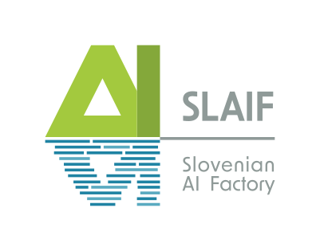
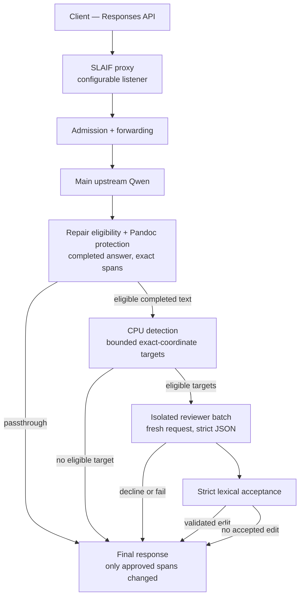

  

# SLAIF LLM Response Language Repair

**A proxy that checks and corrects LLM responses before they reach your application.**

[**Quickstart** — first request in the shortest supported path](QUICKSTART.md) ·
[**Install** — full setup](INSTALL.md)

Works online with your existing LLM service, making small, evidence-supported
language corrections while preserving the rest of each answer. Currently
configured for Slovenian.

Designed with smaller or highly quantized LLMs in mind, especially when working
in languages with less training data and tooling support.

**Your application → Repair proxy → LLM service**

**Your application ← Checked response ← Repair proxy**

This is experimental software that you install and run yourself. The proxy
listens on loopback by default and checks the completed answer
before delivering it when the response is eligible for repair. Other API traffic
passes through to your existing service. Its effectiveness at improving wording has not yet been
systematically measured.

## How it works

One proxy process owns each request end to end. Main generation and the optional
review for one answer are sequential, and the CPU side never loads a second large
model.

## Supported behavior and limits

- **Transparent forwarding** — tools, images, Chat Completions, models/health
  routes, stored conversations and upstream errors pass through. Repair is
  limited to eligible completed text answers from stateless `POST /v1/responses`
  calls with `store: false`; declaring tools does not exclude a final text answer.
  Structured output and tool-call responses are preserved unchanged.
- **Listener** — default `127.0.0.1:18024`; set `CONCEPT_HOST` and `CONCEPT_PORT`
  to choose the bind address and port. `CONCEPT_HOST=0.0.0.0` accepts IPv4 network
  connections. See [proxy chaining](docs/PROXY-CHAINING.md) for the
  `18023 → 18021` configuration and streaming behavior.
- **No repair probabilities** — defined Responses API `logprobs` metadata is
  removed on the eligible repair path, even when no correction is made.
- **Exact, conservative edits** — only approved original-coordinate spans change;
  protected material, formatting and every other code point are preserved.
- **Fail-closed** — a missing or incompatible index, or a technical failure
  of the optional repair after safe completion, returns the completed original;
  truncated transport remains a transport failure. Ineligible envelopes and
  upstream errors pass through without repair or metadata normalization.
- **Mandatory pinned Pandoc 3.7.0.2** for structural original-span protection.
- **External statistics** — real unigram/bigram/trigram counts (CC BY-SA 4.0) are
  not bundled in the repository; the installation fetches them into an external
  read-only index location (INSTALL.md), and the code's Apache-2.0 licence does
  not relicense them.
- **No separate human evaluation dataset**; linguistic benefit is unmeasured.

## Documentation

| Topic | Document |
| --- | --- |
| Architecture and the current runtime | [ARCHITECTURE.md](ARCHITECTURE.md) |
| First request (quickstart) | [QUICKSTART.md](QUICKSTART.md) |
| Full installation | [INSTALL.md](INSTALL.md) |
| Transparent forwarding and proxy chains | [PROXY-CHAINING.md](docs/PROXY-CHAINING.md) |
| Security model | [SECURITY.md](SECURITY.md) |
| Testing and verification strategy | [TESTING.md](TESTING.md) |
| Topic index and navigation | [docs/README.md](docs/README.md) |
| Development history and evidence | [docs/HISTORY.md](docs/HISTORY.md) |
| Product agreement (protected) | [PLAN.md](PLAN.md) |

## License and attribution

The code is released under the [Apache License 2.0](LICENSE). The linguistic
statistics it queries are a separate [CC BY-SA 4.0](https://creativecommons.org/licenses/by-sa/4.0/)
publication, not bundled in the repository (the installation fetches it into an
external index location; see INSTALL.md) and not relicensed by the code. SLAIF
artwork is reused from the SLAIF project.

## Project and support

- Project website: [slaif.si](https://www.slaif.si)
- Questions and bug reports: [GitHub issues](https://github.com/ulfe-lmi/llm-slovenian-repair/issues)
- Security guidance: [SECURITY.md](SECURITY.md)

Maintainers: Janez Perš and Jon Muhovič, Laboratory for Machine Intelligence,
Faculty of Electrical Engineering, University of Ljubljana.

## Acknowledgements

We acknowledge support from the EC/EuroHPC JU and the Slovenian Ministry of
Higher Education, Science and Innovation through SLAIF (grant 101254461).
